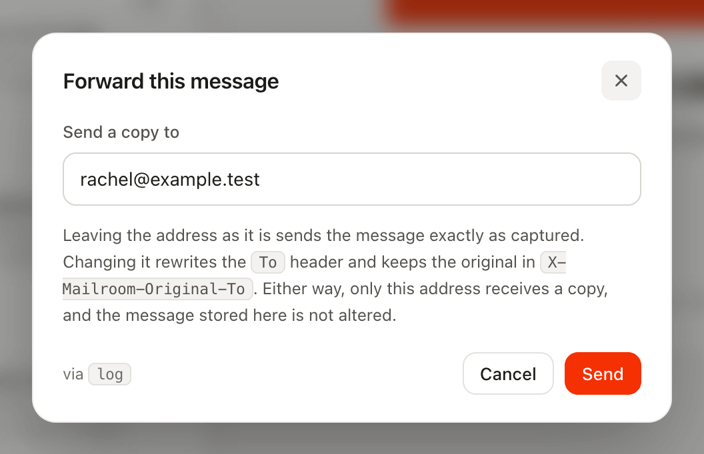
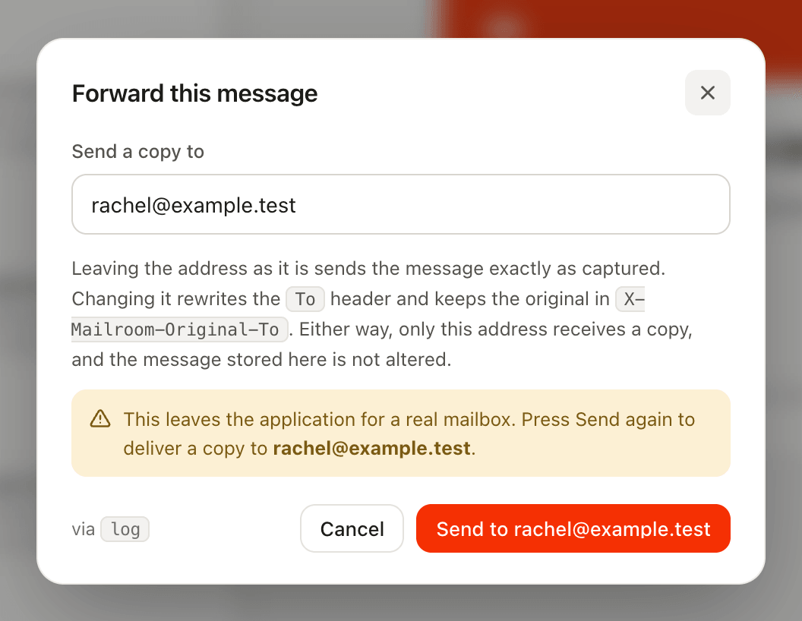

# Forwarding a message

Send a captured message to a real inbox to see how Gmail or Outlook renders it, with limits on where it can go and how often.

The one thing a mailbox cannot show you is how Gmail or Outlook will actually render a message. Name a mailer that can deliver, and each message gains a **Forward** button:

```dotenv
MAILROOM_FORWARD_MAILER=smtp
```

Open a message, click Forward, and send it to yourself. The field starts on the real recipient, and what happens next depends on whether you change it:

| Address | What goes out |
|---|---|
| **Left as it is** | The stored MIME goes out **byte for byte**. What lands in the inbox is exactly what your application produced. |
| **Changed** | `To` is rewritten to your address and `Cc` dropped, with the originals preserved as `X-Mailroom-Original-To` and `X-Mailroom-Original-Cc`, so it reads naturally rather than like a misdelivery. |

> [!NOTE]
> Either way only the address you chose receives anything, and the stored copy is never modified.



Because sending takes a deliberate click, your SMTP bill covers the handful of messages someone actually checked rather than everything the application sent.

## Keeping it safe

The mailbox becomes able to send, so six things bound it:

- **There is nothing to send through until you configure it.** With no `forward.mailer` the route is never registered, so the button explains the setup instead of offering a form.
- **Outside `local`, forwarding needs an authenticated user.** Reading the mailbox and relaying from it are different privileges: opening the mailbox up with a permissive `Mailroom::auth()` callback grants reading, not sending. Set `MAILROOM_FORWARD_REQUIRE_AUTH=false` to accept that anyone who can open the mailbox can send through it.
- **Sending asks first**, naming the address, since the field is pre-filled with a real customer's.
- **A Mailroom mailer is refused as the destination.** It would capture the message again instead of delivering it, leaving you waiting for mail that was never going to arrive.
- **You can bound where mail may go.** `MAILROOM_FORWARD_ALLOWED` takes a comma-separated list of whole addresses, or `@domain` to permit everyone there. Empty means anywhere, which is the default.
- **And how often.** `MAILROOM_FORWARD_RATE_LIMIT` caps forwards per minute, counted per signed-in user and otherwise per IP. Ten by default; `null` removes the ceiling.



On a staging box several people share, those last two are what turn a send button into a bounded one:

```dotenv
MAILROOM_FORWARD_MAILER=smtp
MAILROOM_FORWARD_ALLOWED=@yourcompany.com
MAILROOM_FORWARD_RATE_LIMIT=10
```
