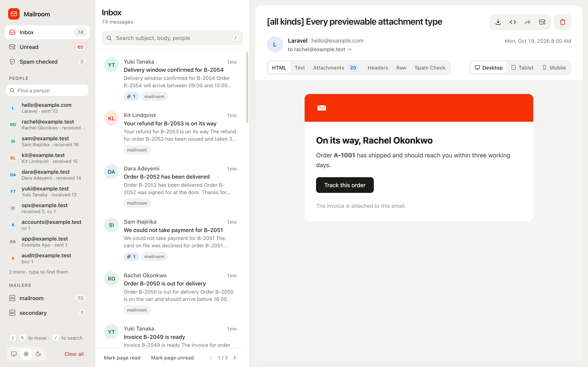

# Introduction

Mailroom is a Laravel mail driver that stores outgoing mail in your database, plus a mailbox at `/mailroom` to read it.

`MAIL_MAILER=log` flattens a message into a log line and throws away the attachments. `MAIL_MAILER=array` forgets everything at the end of the request. Mailroom keeps the whole thing: full MIME, attachments, embedded images, tags, metadata, custom headers. And it gives you somewhere to look at it.

There is nothing else to run: no Docker container, no SMTP port to point the app at, no account with a hosted inbox. The mailbox is a route in your application, so it works the same on a laptop, in CI and on a staging server your testers share.

The mail stays in your own database and storage, so no third party holds copies of your users' emails, and pruning deletes them on a schedule you set. It leaves only when someone forwards a message or runs a spam check, and both are off until you configure them.

## What gets captured

Everything Laravel's mail layer can produce. Mailroom hooks in as a Symfony transport rather than an event listener, so it sees the finished message:

- HTML and text bodies, from views, markdown, `htmlString` or `Mail::raw()`
- Attachments via `attach()`, `attachData()`, `fromStorage()` and the rest, byte for byte
- Inline images from `$message->embed()`, kept separate from real attachments
- `Cc`, `Bcc`, `Reply-To`, and the envelope recipients actually delivered to
- Tags and metadata (`TagHeader` / `MetadataHeader`)
- Custom headers set through `withSymfonyMessage()`
- Queued mailables, multiple mailers, `Mail::alwaysTo()`

## Where to next

- [Installation](./installation.md): two commands, and what the installer does for you.
- [Reading mail](./mailbox.md): the mailbox, its mailboxes and people, and the keyboard.
- [Access control](./access-control.md): who can open the mailbox outside `local`.
- [Staging and QA](./staging.md): running it on an environment your testers share.
