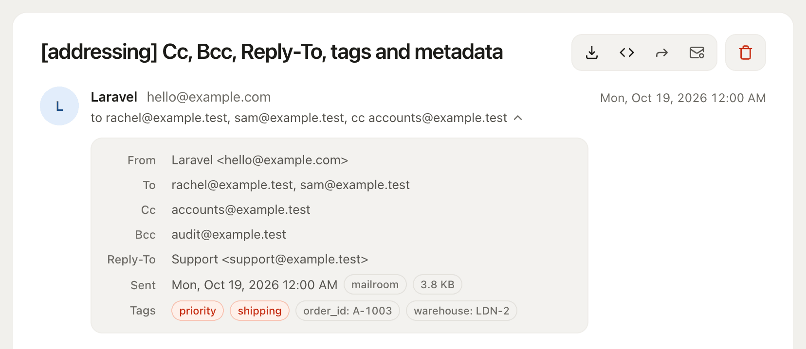
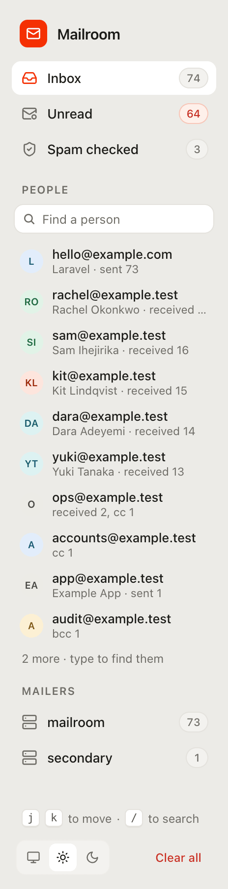
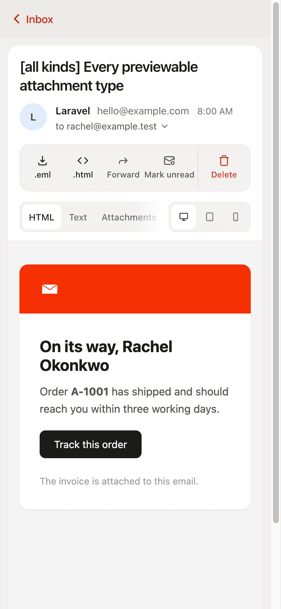
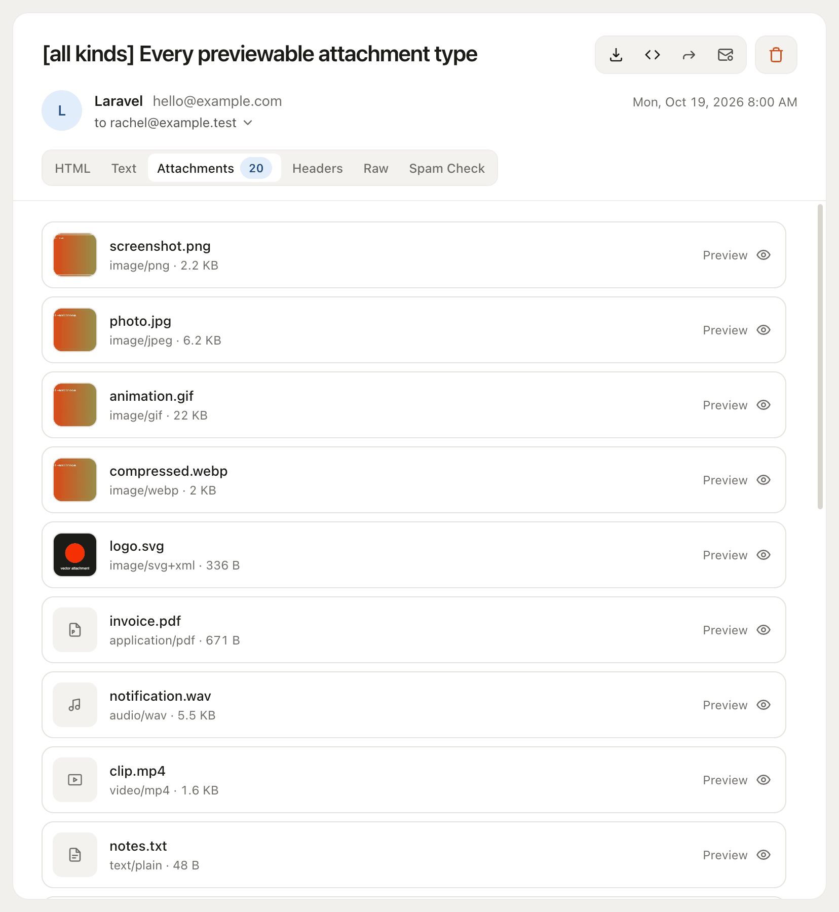
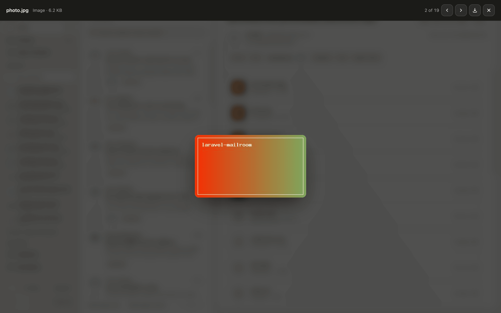

# Reading mail

`/mailroom` is a mail client for what your application sent: mailboxes and people, search, the keyboard, and every message in full.

The sidebar holds the mailboxes and people, then comes the message list, then the message itself with HTML, text, attachments, headers, raw and spam check tabs. Light, dark and system themes.

Each message opens on a compact header: the subject and a toolbar, then the sender, who it went to, and when. The line naming the recipients opens a panel with every address (To, Cc, Bcc, Reply-To), the size, the mailer and the tags, so the header stays the same height whether a message carries two addresses or seven, and the email itself starts near the top of the pane.

No build step, no npm, no published assets. The styles are inlined, so it works offline and behind a strict CSP.

## Mailboxes and people

The sidebar filters the list:

- **Inbox**: everything captured, newest first.
- **Unread**: what you have not opened yet. It appears only when someone is signed in; see [Read and unread](#read-and-unread).
- **Spam checked**: every message that has been through the [spam check](./spam-check.md), highest score first, so the one worth looking at is at the top.
- **People**: the ten addresses that appear on the most messages, as sender, recipient, Cc or Bcc, with a count of the rest. Clicking one lists every message it is on. The box above them finds anyone else by address or name, as you type.
- **Mailers**: one entry per mailer that captured mail. It appears only when there is more than one, which happens when an application sends through named mailers of its own.

The sidebar shows one view at a time, the way folders do: choosing a mailbox, a person or a mailer replaces the previous choice, and Inbox always means all mail. Search narrows whichever view is showing. The counts in the sidebar cover the whole mailbox; the heading above the list counts what the list is showing.

Row counts are coloured so they read at a glance: attachments in blue, and a spam score green below 2, amber from 2, and red from SpamAssassin's own threshold of 5.

## Keyboard

- `j` / `k` open the next and previous message in the list.
- `/` jumps to the search box.
- `Esc` in a search box clears it.

Nothing else is bound, so a stray key can at worst open a different message. Shortcuts are ignored while you are typing in a field and while the forward dialog or an attachment preview is open.

Both search boxes update as you type, a moment after you stop. The message search keeps the address bar in step, so a refresh or a shared link shows the same results, and matches are highlighted in the list. Searching with a message open closes it to show the results, as Gmail does. With scripting off, pressing Enter searches instead.

## Desktop, tablet and mobile

Most of the mail an application sends is read on a phone, so the rendered body can be viewed at three widths:

- **Desktop**: fills the pane, which is the default
- **Tablet**: 768px
- **Mobile**: 375px

An iframe carries its own viewport, so the message's own media queries fire at the chosen width: what you see is what a client that size would lay out, not a scaled picture of it. The choice is kept in your browser and applies to every message you open, since someone checking a staging run at phone width is usually checking all of it.

The mailbox itself adapts too. On a tablet the sidebar narrows to a rail of icons and avatars. On a phone the list and the message are separate screens, with a link back to the list, and the message toolbar spells out its buttons, since there is no hover to show a tooltip.

## Read and unread

Where the mailbox sits behind a login, it keeps track of what each person has read. Opening a message marks it read, unread rows keep the bolder subject and carry a dot, and the **Unread** mailbox lists and counts what is still waiting. **Mark unread** puts one back, and a whole page can be marked either way at once.

It is per person, so two testers working through the same staging mailbox never clear each other's mail. With nobody signed in there is nobody to attribute a read to, so the markers, the controls and the count are all absent.

## Exporting

Every message can be exported as:

- **`.eml`**: opens in Mail.app, Thunderbird and Outlook
- **`.html`**: a standalone file with embedded images rewritten to `data:` URIs, so it renders anywhere

## Attachment previews

Click an attachment to open it in a lightbox. Arrow keys move between attachments, `Esc` closes, clicking outside dismisses, and the open preview stays in the URL (`#preview-2`) so it survives a refresh and can be pasted to someone else.

| Previewed inline | Download only |
|---|---|
| PNG, JPEG, GIF, WebP, AVIF, BMP, ICO, SVG | Office: `.docx`, `.xlsx`, `.pptx` |
| PDF | Archives: `.zip`, `.7z` |
| MP3, WAV, OGG, M4A, AAC, FLAC | TIFF, HEIC |
| MP4, WebM, OGV, MOV | anything unrecognised |
| Text, Markdown, CSV/TSV (as a table), JSON (pretty-printed) | |
| HTML, XML, YAML, JS, CSS, SQL (as **source**) | |
| `.ics` invites (parsed), `.eml` messages (headers + body) | |

Media previews support HTTP Range, so seeking in audio and video works.

**Office documents genuinely cannot be previewed here.** Gmail and Outlook render them with server-side viewers such as Google Docs Viewer and Office Online, and those services must fetch the file over the public internet. A dev mailbox on `127.0.0.1` behind an auth gate is unreachable to them. The self-hosted alternative is a multi-megabyte JS bundle this package has no build step for, so rather than half-render them the mailbox says "no preview for .docx" and offers the download.

TIFF and HEIC are left out for a smaller reason: Safari draws them and Chrome does not, so a preview would work on one machine and look broken on another.

Set `preview.enabled` to `false` to switch previews off and go back to plain downloads.

### How previewing stays safe

Serving an attachment under its own MIME type is how stored XSS happens, so the preview route is separate from the download route and hardened on its own terms:

- The content type comes from an **allowlist**, never from the attachment's `mime_type`, which is untrusted input.
- Anything text-shaped is **never served at all**. It is escaped into the page server-side, so an emailed `.html` or `.js` is shown as source.
- SVG renders only through ``, under a `Content-Security-Policy: sandbox` response header.
- Downloads are always `application/octet-stream` with `Content-Disposition: attachment`.

PDF is a deliberate, documented exception to the sandbox. [SECURITY.md](https://github.com/ebbbang/laravel-mailroom/blob/main/SECURITY.md) has the full threat model and the reasoning.
