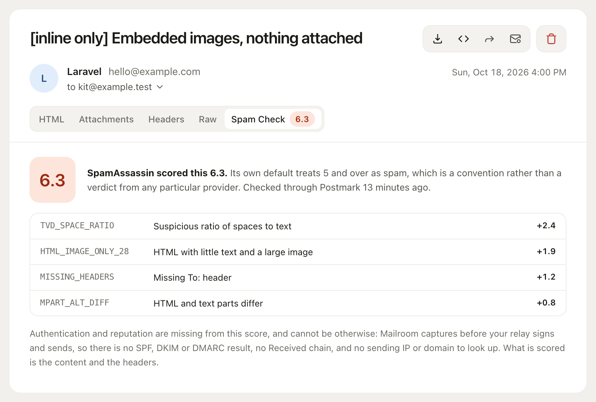

# Spam check

Score a captured message with SpamAssassin through Postmark's free API, and see every rule that fired and what each one cost.

Each message has a **Spam Check** pane. Set a driver to turn it on:

```dotenv
MAILROOM_SPAM_DRIVER=postmark
```

The scoring is done by [Postmark's SpamCheck API](https://spamcheck.postmarkapp.com/), which is free and needs no account. Mailroom scores nothing itself: SpamAssassin's weights come from a corpus it was trained against, and a number invented here would look like theirs while meaning much less.



## What leaves your application

This is the one feature that sends captured mail anywhere. A check posts the **whole message, attachments included**, to Postmark.

So it is off until you set a driver, and until then the route that would send it does not exist. Once on, nothing is sent until somebody opens a message and clicks the button, the same way forwarding works. Outside `local`, checking needs a signed-in user; set `MAILROOM_SPAM_REQUIRE_AUTH=false` to let anyone who can open the mailbox check messages. `MAILROOM_SPAM_RATE_LIMIT` caps checks per minute, counted per signed-in user and otherwise per IP.

The result is kept on the message, so coming back to it costs nothing. Checking again replaces it.

## What the score can and cannot see

Worth knowing before you act on a number:

- The score is **SpamAssassin's**, computed by Postmark, on the message as captured. Its own default treats 5 and over as spam. That is a convention, not a verdict from Gmail or anyone else.
- It **cannot** include SPF, DKIM or DMARC results, or anything about your sending IP or domain. Mailroom captures at the transport, before your relay signs and sends, so none of that exists yet.
- Some rules read delivery rather than content, and a message that has not been delivered can trip them. A missing `Received` chain is the usual one.

What it does see is the content and the headers, which is where most of what you can actually fix lives: a missing text part, an image-heavy body, an absent `List-Unsubscribe`, a subject that reads like a promotion.
